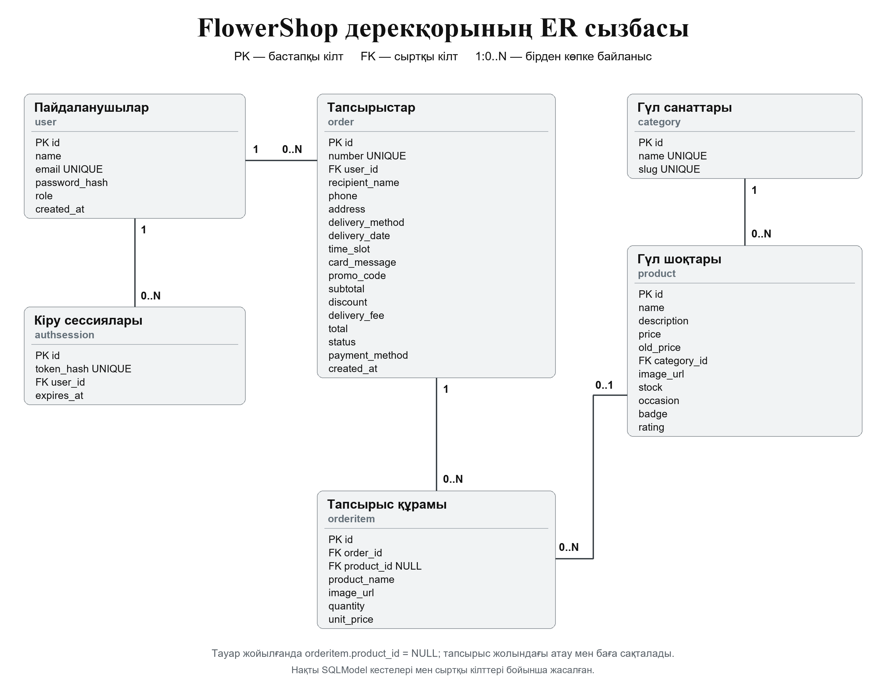
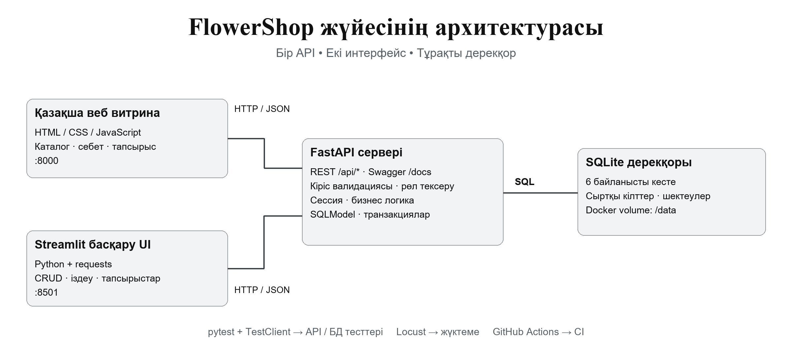

# FlowerShop — гүлдерге онлайн тапсырыс беру жүйесі

Қазақ тіліндегі толық циклді оқу жобасы: заманауи дүкен витринасы, дерекқоры бар FastAPI сервері, Streamlit басқару панелі және 1–8 зертханалық жұмыстардың материалдары.

**Курс:** Ақпараттық жүйелердің қолданбалы бағдарламалық қамтамасыз етілуі, 2026 жыл  
**Автор:** ____________________  
**Топ:** ____________________

## 1. Пәндік сала

FlowerShop гүл шоқтарын онлайн таңдауды және тапсырыс беруді автоматтандырады. Сатып алушы каталогтан қажетті гүлді іздеп, баға мен санат бойынша сүзеді, таңдаулылар мен себетті қолданады. Тіркелген пайдаланушы алушының мәліметін, жеткізу күнін және ашықхат мәтінін беріп, тапсырыс жасайды. Әкімші тауарларды, қойма қорын және тапсырыс күйлерін басқарады. Төлем жеткізу кезінде жасалады; сайт банк картасының деректерін жинамайды.

### Мүмкіндіктер

- Телефонға және компьютерге бейімделетін қазақша интерфейс.
- Каталог, іздеу, санат және баға сүзгілері, сұрыптау, тауар карточкасы.
- Таңдаулылар, себет, санын өзгерту, `GUL10` промокоды.
- Тіркелу, кіру, шығу, жеке тапсырыстар тарихы.
- Курьер немесе алып кету, күні мен уақыты, алушы, ашықхат мәтіні.
- Тауардың нақты бағасын және жеткізу сомасын серверде есептеу.
- Қойма санын тексеру, тапсырысты бір транзакциямен сақтау.
- Әкімшіге арналған CRUD және тапсырыс күйін басқару.

## 2. Деректер архитектурасы



[Өңделетін SVG диаграммасы](docs/images/er-diagram.svg)

| Кесте | Мақсаты | Байланыс |
|---|---|---|
| `category` | Гүл санаттары | Бір санатта бірнеше `product` |
| `product` | Баға, сипаттама, сурет, қойма | `category_id`; тапсырыс жолдары |
| `user` | Пайдаланушы, email, құпиясөз хеші, рөл | Бір пайдаланушыда бірнеше тапсырыс/сессия |
| `authsession` | Мерзімі бар кіру токенінің хеші | `user_id` → `user.id` |
| `order` | Жеткізу, сомалар, күй, алушы | `user_id` → `user.id` |
| `orderitem` | Тапсырыс кезіндегі тауар атауы/бағасы/саны | `order_id`, nullable `product_id` |

Тауар жойылса, бұрынғы тапсырыстың атауы мен бағасы сақталады, ал `orderitem.product_id` бос болады. БД файлы репозиторийге қосылмайды. Seed 4 санат, 12 тауар, 3 үлгі пайдаланушы және 3 үлгі тапсырыс жасайды. Үлгі пайдаланушыларға ашық құпиясөз берілмейді. Кіру сессиялары тек нақты аутентификациядан кейін пайда болады.



## 3. Технологиялық стек

| Қабат | Құрал |
|---|---|
| Сервер | Python 3.11+, FastAPI, Uvicorn |
| Деректер | SQLite, SQLModel, SQLAlchemy |
| Дүкен витринасы | HTML, CSS, JavaScript |
| Зертханалық басқару UI | Streamlit, Requests, Pandas |
| Тестілеу | pytest, FastAPI TestClient, httpx, pytest-cov |
| Жүктеме және қауіпсіздік | Locust, psutil, Bandit |
| Инфрақұрылым | Docker, Docker Compose, GitHub Actions |
| AI көмекшісі | Codex: код, сценарийлер, тексеру және құжаттау |

## 4. Іске қосу

### Docker арқылы

Docker Desktop және Git орнатылған болуы керек.

```bash
git clone https://github.com/kenzebalnr-ux/FlowerShop.git
cd FlowerShop
```

`.env.example` файлын `.env` ретінде көшіріп, `FLOWERSHOP_ADMIN_PASSWORD` үшін кемінде 8 таңбалы, әріп пен саны бар жеке құпиясөз енгізіңіз. `.env` Git-ке жіберілмейді. Өріс бос қалса, әдепкі әкімші құрылмайды; каталог пен сатып алушы тіркелуі жұмыс істейді.

```bash
docker compose up --build
```

| Қызмет | Мекенжай |
|---|---|
| Дүкен | http://localhost:8000 |
| Streamlit басқару панелі | http://localhost:8501 |
| Swagger API | http://localhost:8000/docs |
| Денсаулық тексеруі | http://localhost:8000/api/health |

Әкімші поштасы `.env` ішінде орнатылады, әдепкісі — `admin@flowershop.kz`. Құпиясөзді өзгерткенде бұрынғы тіркелгі автоматты қайта жазылмайды. SQLite деректері `flowershop_data` volume-інде сақталады.

### Python арқылы

```bash
python -m venv .venv
```

Windows PowerShell: `.\.venv\Scripts\Activate.ps1`  
macOS/Linux: `source .venv/bin/activate`

```bash
python -m pip install -r requirements.txt -r frontend/requirements.txt
python -m backend.seed
python -m backend.create_admin
python -m uvicorn backend.main:app --reload
```

Әкімшіні құру командасы email және құпиясөзді терминалда сұрайды; құпиясөз экранға шықпайды. Басқа терминалда сол виртуалды ортаны белсендіріп:

```bash
python -m streamlit run frontend/streamlit_app.py
```

Жергілікті Streamlit әдепкіде `http://127.0.0.1:8000` API-ін қолданады. Docker ішінде `BACKEND_URL=http://backend:8000` қойылады.

## 5. Тесттер

```bash
python -m pip install -r requirements-dev.txt
python -m pytest -v --cov=backend --cov-report=term-missing
python -m bandit -r backend
```

Тесттер бөлек SQLite базасын пайдаланады. Нақты тексеру нәтижесі: **57/57 тест өтті**, backend жолдық қамтуы **84,28%**, Bandit: **0 finding**. [Тест журналы](docs/results/pytest.txt) және [толық есеп](docs/labs/08-testing-report.md) репозиторийде сақталған. Жүктеме тесті уақытша дерекқоры бар оқшау серверді өзі іске қосады:

```bash
python scripts/run_load.py --start-server
```

Сценарийлер: 5 қолданушы × 60 секунд; 20 × 120; 50 × 180; 100 × 180. Нақты толық өлшеу: **36,503 сұрау, 0 қате**; [жүктеме диаграммасы](docs/images/load-results.png) және [бастапқы өлшем](docs/results/load/summary.json) сақталған. `--quick` тек қысқа тексеруге арналған және толық зертхананы алмастырмайды. Өлшемдер `docs/results/load/` ішінде сақталады. Өз серверін қолдану үшін `--server-pid <PID> --host http://127.0.0.1:8000` параметрлерін беруге болады. Жүктемені тек өзіңіз іске қосқан жергілікті серверге бағыттаңыз.

Браузерде тіркелу, себет, промокодпен тапсырыс және мобильді көрініс тексерілді. CI оқу тармағында нақты [қате run](https://github.com/kenzebalnr-ux/FlowerShop/actions/runs/45586463267) және [түзетілген сәтті run](https://github.com/kenzebalnr-ux/FlowerShop/actions/runs/45586997382) бар.

Негізгі жобаның [толық CI тексеруі де сәтті өтті](https://github.com/kenzebalnr-ux/FlowerShop/actions/runs/45587968844): pytest, Bandit, Compose және екі Docker build. `python scripts/api_checks.py` нақты HTTP арқылы 8/8 сценарийді тексерді.

Нақты автоматтандырылған тексерулер, жүктеме өлшемдері, шектеулер және CI дәлелдері [8-зертхана есебінде](docs/labs/08-testing-report.md) жинақталады.

## 6. Жоба құрылымы

```text
backend/
  main.py            FastAPI, API маршруттары және веб витрина
  models.py          SQLModel кестелері және байланыстар
  schemas.py         Кіріс деректерін тексеру
  db.py              Engine, сессия және SQLite баптауы
  seed.py            Бастапқы каталог және үлгі деректер
  security.py        Хештер, токендер және рөл тексеруі
  create_admin.py    Қауіпсіз әкімші құру командасы
  Dockerfile         Backend контейнері
frontend/
  static/            Дүкеннің HTML/CSS/JavaScript файлдары
  streamlit_app.py   Зертханалық басқару интерфейсі
  Dockerfile         Streamlit контейнері
tests/               Интеграциялық, қауіпсіздік және жүктеме тесттері
scripts/             Жүктеме өлшеу құралдары
docs/
  images/            ER және компонент диаграммалары
  labs/              1–8 зертхана есептері
  results/           Нақты өлшеу нәтижелері
.github/workflows/   CI сценарийі
docker-compose.yml   Екі сервисті іске қосу
```

Әдістемедегі `app/database`, `app/routers`, `app/frontend` рөлдері осы жобада тиісінше `backend/db.py` + `backend/models.py`, `backend/main.py`, `frontend/streamlit_app.py` файлдарына бөлінген.

## 7. Зертханалық жұмыстар

| № | Тақырып | Материал |
|---|---|---|
| 1 | Жобалау, Git, ER | [Есеп](docs/labs/01-architecture.md) |
| 2 | Дерекқор, SQLModel, seed | [Есеп](docs/labs/02-database.md) |
| 3 | GET, POST, FastAPI | [Есеп](docs/labs/03-api.md) |
| 4 | PUT/PATCH, DELETE, сүзу | [Есеп](docs/labs/04-crud.md) |
| 5 | Streamlit және HTTP интеграциясы | [Есеп](docs/labs/05-streamlit.md) |
| 6 | Docker және Compose | [Есеп](docs/labs/06-docker.md) |
| 7 | Автотест және қорғау | [Есеп](docs/labs/07-tests.md) |
| 8 | Интеграция, жүктеме, қауіпсіздік, CI | [Есеп](docs/labs/08-testing-report.md) |

[Талаптардың орындалу картасы](docs/lab-mapping.md)

## 8. Қолдану шегі

Бұл оқу жобасы. Тапсырыстар БД-да сақталады; карта төлемі мен курьер қызметінің сыртқы интеграциясы қосылмаған. Өндірістік іске қосу үшін HTTPS, резервтік көшіру, PostgreSQL, құпияларды басқару және нақты жеткізу/төлем провайдері қажет. Тауар суреттері сыртқы HTTPS URL арқылы жүктеледі, сондықтан сурет көрсетуге интернет керек. Өлшеу қорытындылары тек есепте көрсетілген ортаға қатысты.
