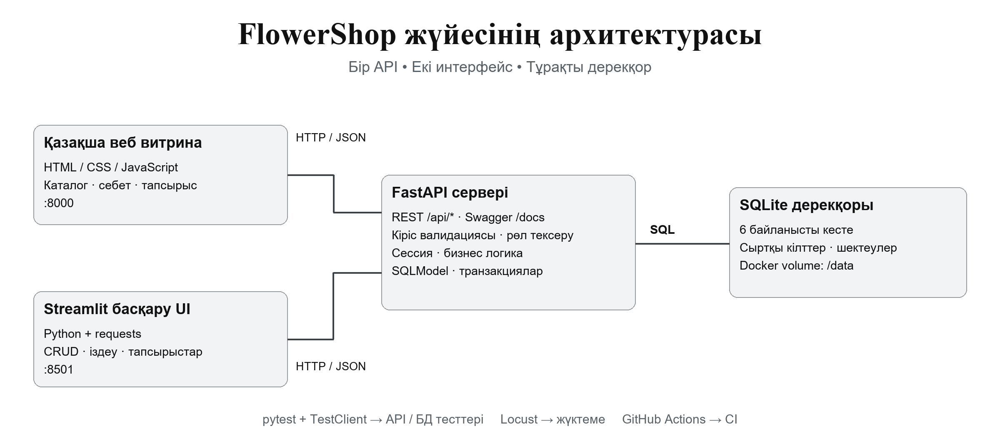
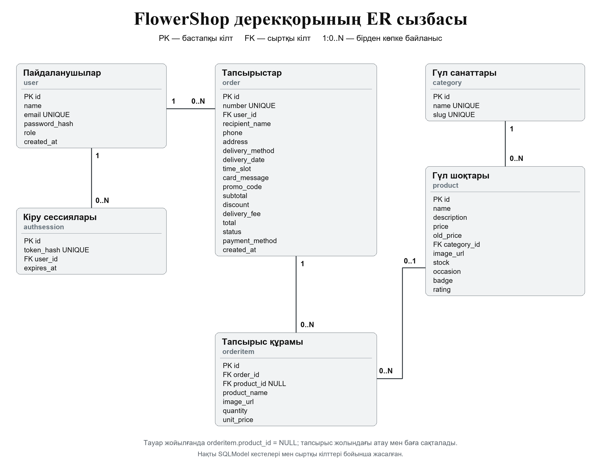

# 1-зертханалық жұмыс — Жобалау және жұмыс ортасы

## Мақсат және нәтиже

FlowerShop гүл дүкеніне арналған ақпараттық жүйенің құрылымы жасалды. Сатып алушы гүлдерді қарап, іздеп, себет жинап, тапсырыс береді. Әкімші тауарлар мен тапсырыстарды басқарады. Деректер API арқылы реляциялық дерекқорда сақталады.

## Архитектура

Браузердегі витрина FastAPI API-іне сұрау жібереді. Streamlit басқару интерфейсі де сол API-ді `requests` арқылы пайдаланады. SQLModel модельдері SQLite кестелеріне сәйкес келеді. Сатып алушы мен әкімші құқықтары серверде тексеріледі.

Бастапқы тұжырымдамалық мәндер: категория, тауар, пайдаланушы және тапсырыс. Тапсырыс пен тауар арасындағы байланысты тапсырыс жолы кестесі сақтайды. Нақты модельдер мен өрістер backend кодында берілген.

## Орындалған жұмыс

- Python API, дерекқор, веб интерфейс және тесттер бөлек модульдерге бөлінді.
- Тәуелділіктер жеке файлдарда берілді.
- `.gitignore` виртуалды ортаны, дерекқорды және `.env` құпияларын алып тастайды.
- Жоба `kenzebalnr-ux/FlowerShop` репозиторийіне арналған.
- Кодты дайындауға және тексеруге Codex қолданылды. Өзге IDE орнатылды деп мәлімделмейді.

## Қорғау сұрақтарына жауап

1. **venv не үшін керек?** Жобаның кітапхана нұсқаларын басқа Python жобаларынан бөледі. Оны қолданбаса, нұсқа қақтығыстары тууы мүмкін.
2. **.gitignore қызметі қандай?** Генерацияланған файлдар мен құпияларды жаңа Git жазбаларына қоспайды. Бұрын commit жасалған құпияны өшірмейді; ондай құпияны ауыстыру керек.
3. **AI көмегі мен тәуекелі қандай?** Қаңқа код пен тест сценарийлерін жылдам дайындайды. Нәтижені тексермей қабылдаса, қате логика немесе қауіпсіздік кемшілігі қалуы мүмкін.
4. **Ветка не үшін керек?** Өзгерісті бөлек әзірлеп, тексерген соң негізгі тармаққа біріктіруге мүмкіндік береді.
5. **commit пен push айырмасы?** Commit жергілікті Git тарихына күйді сақтайды, push сол коммиттерді қашықтағы репозиторийге жібереді.
