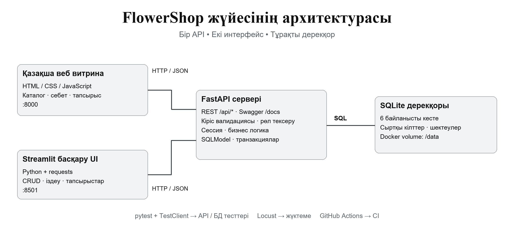

# 8-зертханалық жұмыс — Интеграциялық, жүктемелік және қауіпсіздік тесттері

**Жоба:** FlowerShop  
**Күні:** 2026 жылғы 25 қараша  
**Автор:** ____________________  
**Топ:** ____________________

## 1. Мақсат және тест нысаны

FlowerShop-тың интерфейс, API, дерекқор және авторизация қабаттарының бірлескен жұмысын тексеру. Тапсырыс кезіндегі қойма мен соманың дұрыстығы, рөл шектеулері, деректер бүтіндігі және жүктеме кезіндегі жауап уақыты бағаланады. Автотест пен CI қайталанатын тексеруді қамтамасыз етеді.

## 2. Архитектура және ықтимал қателер



| Компонент | Міндеті | Ықтимал қате 1 | Ықтимал қате 2 |
|---|---|---|---|
| Веб интерфейс | Каталог, себет, тапсырыс | Себет саны мен сома сәйкес емес | API қатесі қолданушыға көрсетілмейді |
| Streamlit | Әкімші CRUD | Қайта орындалғанда кіру күйі жоғалады | Backend тоқтағанда интерфейс құлайды |
| FastAPI | HTTP, бизнес ережелер | Жарамсыз кіріс қабылданады | Қойма жеткіліксіз болса жартылай тапсырыс сақталады |
| SQLModel / SQLite | Тұрақты сақтау | FK жоқ объектіні көрсетеді | Rollback жасалмай, қалдық өзгеріс қалады |
| Авторизация | Сессия және рөл | Клиент әкімші әрекетін орындайды | Құпиясөз/токен API не журналға шығады |
| Docker / CI | Қайталанатын орта | Контейнердегі localhost қате сервиске нұсқайды | Тест қатесі pipeline нәтижесіне әсер етпейді |

## 3. Құралдар және әдіс

- `pytest`, `httpx`, FastAPI `TestClient`: API және БД сценарийлері.
- `pytest-cov`: backend кодын орындау қамтуы.
- `Locust`: тұрақты пайдаланушы топтарымен HTTP жүктеме.
- `psutil`: сервер процесінің CPU пайызы мен RSS жадын өлшеу.
- `Bandit`: Python кодындағы ықтимал қауіптерді статикалық іздеу.
- `GitHub Actions`: тест, қауіпсіздік тексеруі, Compose валидациясы және Docker build.

TestClient сценарийлері бөлек SQLite базасын қолданады. Өлшеу сервері нақты дүкен деректерінен бөлек іске қосылуы тиіс. Жүктеме нәтижелері сервер CPU/RAM ресурстарымен және сол ортадағы желі жағдайымен ғана салыстырылады.

## 4. Интеграциялық сценарийлер

| ID | Әрекет | Күтілетін нәтиже | Автотест |
|---|---|---|---|
| I01 | GET каталог және жеке тауар | 200, нақты JSON | `test_catalog_and_detail` |
| I02 | Іздеу, санат, баға, сұрыптау | Тек сәйкес тауарлар | `test_search_filter_and_sort` |
| I03 | Жоқ ID | 404 | `test_not_found` |
| I04 | Әкімші POST, PUT, PATCH, DELETE | 201 → жаңару → 204; дерек қайта оқылады | `test_product_crud` |
| I05 | Тапсырыс беру | Order/OrderItem сақталады, stock азаяды | `test_order_persists_and_stock_decreases` |
| I06 | Промокод және алып кету | 10% жеңілдік, жеткізу ақысы 0 | `test_promo_and_pickup` |
| I07 | Қайталанған себет жолы | Қате, артық сату жоқ | `test_duplicate_lines_do_not_oversell` |
| I08 | Бір позицияда қойма жетпеуі | Бүкіл операция кері қайтады | `test_failed_order_rolls_back_all_items` |
| I09 | БД CRUD және rollback | Create/read/update/delete; rollback қалдық қалдырмайды | `test_database_crud_and_rollback` |

## 5. Қауіпсіздік сценарийлері

| ID | Сценарий | Күтілетін әрекет |
|---|---|---|
| S01 | Бос/қысқа/сансыз/әріпсіз құпиясөз | Тіркелу қабылданбайды |
| S02 | Қате login немесе пароль | 401, тіркелгі деректері ашылмайды |
| S03 | Токенсіз қорғалған ресурс | 401 |
| S04 | Сатып алушы әкімші маршрутын шақырады | 403 |
| S05 | Қате JSON / формат | 400, traceback жоқ |
| S06 | Пайдаланушы жауабы | password_hash және токен хеші жоқ |
| S07 | Өзгенің тапсырысы | Қол жеткізілмейді |
| S08 | Logout-тан кейін ескі токен | Жарамсыз |
| S09 | Нөл/теріс/тым үлкен сан | Қабылданбайды |
| S10 | Клиент role немесе unit_price жібереді | Сервер басқарылатын өрістер қабылданбайды |
| S11 | SQL injection мәтіні | SQL емес, қарапайым іздеу мәтіні ретінде қаралады |
| S12 | Құпиясөздің журналға шығуы | Журналда құпиясөз жоқ |

Құпиясөздер salt-пен хештеледі. Дерекқорда ашық bearer токенінің орнына оның хеші сақталады. Тапсырыс бағасын клиент анықтамайды. Бұл сценарийлердің өтуі толық penetration test жүргізілді дегенді білдірмейді.

## 6. Автоматты тест нәтижелері

Алғашқы толық іске қосуда **56 тест өтті, 1 тест құлады**. Құлаған тексеру `password` өрісінің атауын енгізілген құпиясөзбен шатастырған тым қатаң assertion болды. Бұл тексеру нақты құпия мәннің жариялануын тексеретіндей түзетілді. Жеке unit жиынтығында **30 тест өтті**; [unit есебі](../results/unit-tests.xml) және [мәтіндік нәтиже](../results/unit-pytest.txt) сақталған. Түзетуден кейінгі **толық жиынтық: 57/57 тест өтті**, қате/сәтсіздік жоқ, орындалу уақыты **27,38 секунд**. Backend жолдық қамтуы **84,28%** (461/547 жол; консольде 84%-ға дөңгелектенген). Орта: Windows, Python 3.12.14. Starlette TestClient-тің httpx туралы бір deprecation ескертуі бар; тесттерді тоқтатпаған.

| Дәлел | Нәтиже |
|---|---|
| [pytest мәтіндік журналы](../results/pytest.txt) | 57 passed, 0 failed: 9 интеграциялық + 18 қауіпсіздік + 30 unit |
| [JUnit XML](../results/tests.xml) | Әр сценарийдің нәтижесі мен уақыты |
| [Coverage XML](../results/coverage.xml) | 84,28% жолдық қамту |
| [Bandit JSON](../results/bandit.json) | 0 finding |
| [Жиынтық JSON](../results/test-summary.json) | Қайта оқуға арналған қысқаша көрсеткіштер |

Интерактивті `create_admin.py` командасы автоматты тестпен қамтылмаған (0%). Сондықтан 84% жалпы көрсеткіш барлық енгізу жолы тексерілді дегенді білдірмейді. Bandit-тегі `token_type="bearer"` үшін жалған B105 ескертуі тек сол протокол тұрақтысына берілген түсіндірмелі suppression арқылы түзетілді; басқа ережелер өшірілген жоқ.

### Браузерде орындалған толық сценарий

Сценарий нақты браузерде жасанды `flowershop-qa@example.invalid` тіркелгісімен орындалды. Бұл деректер нақты клиентке тиесілі емес.

| Әрекет | Бақыланған нәтиже |
|---|---|
| Тіркелу | Сәтті, пайдаланушы кабинеті ашылды |
| №1 тауарды таңдаулыға және себетке қосу | Сәтті |
| `GUL10` промокоды бар тапсырыс | `FS-683B35F8` сақталды |
| Сома | 18 900 − 1 890 + 1 500 = **18 510 ₸** |
| Жеке тапсырыстар тарихы | Жасалған тапсырыс көрінді |
| «Көктем» іздеуі | 2 тауар табылды |
| 375 × 812 мобильді экран | Беттің көлденең артық ені жоқ |
| JavaScript қате журналы | 0 қате |

[Браузер тексерулерінің құрылымды жазбасы](../results/browser-checks.json). Бұл кесте орындалған әрекеттердің есебі; браузер скриншоты ретінде берілмейді.

## 7. Жүктеме сценарийлері

| Бір мезеттегі пайдаланушы | Ұзақтығы | Өлшемдер |
|---:|---:|---|
| 5 | 60 секунд | Сұрау саны, RPS, орташа/p95 жауап, қате %, CPU, RAM |
| 20 | 120 секунд | Сол өлшемдер |
| 50 | 180 секунд | Сол өлшемдер |
| 100 | 180 секунд | Сол өлшемдер |

```bash
python scripts/run_load.py --server-pid <сервер PID>
```

`docs/results/load/summary.json` — жиынтық өлшем; `*_stats.csv` — Locust нәтижесі; `*-resources.json` — сервер ресурстарының уақыт қатары. CPU бір процестің өлшемі; көп ядролы ортада 100%-дан асуы мүмкін. RSS — процеске бөлінген физикалық жад; бүкіл компьютердің RAM көлемі емес.

50 және 100 пайдаланушыны салыстырғанда тек RPS-ті емес, p95, қате үлесін және CPU/RAM өзгерісін бірге қарау керек. Пайдаланушы саны екі есе көбейсе, throughput дәл екі есе артады деп күтуге болмайды. Нақты мәндер өлшеуден кейін беріледі.

## 8. CI және қате енгізу тәжірибесі

`.github/workflows/tests.yml` push, pull request немесе қолмен іске қосылғанда Python тәуелділіктерін орнатады, pytest/coverage және Bandit жүргізеді. Бөлек job Compose конфигурациясын және контейнер build-ын тексереді. Артефакттар `always()` шартымен сақталады, сондықтан тест құлаған жағдайда да нәтиже жоғалмайды.

`lab8-ci-quality-demo` тармағында бақыланатын көбейту функциясының қатесі енгізіліп, нақты GitHub Actions іске қосылды. Қате түзетілген соң қайта іске қосу сәтті аяқталды.

| Кезең | Commit | Нақты нәтиже |
|---|---|---|
| Әдейі енгізілген қате | `9a351de4b3dbf6080b4af771e9268af08a864dc1` | [Құлаған run 45586463267](https://github.com/kenzebalnr-ux/FlowerShop/actions/runs/45586463267) |
| Көбейту логикасын түзету | `fddc9f04348df78946f48094cb2f303441e8cb87` | [Өткен run 45586997382](https://github.com/kenzebalnr-ux/FlowerShop/actions/runs/45586997382) |

[CI тәжірибесінің құрылымды дәлелі](../results/ci-demo.json). Бұл тәжірибе pipeline қате тестті тоқтататынын және түзетуді қайта тексеретінін көрсетеді. Ол негізгі тармақтың толық API/қауіпсіздік/Docker pipeline нәтижесін алмастырмайды; негізгі pipeline күйі бөлек тіркеледі.

## 9. Түзетулер және шектеулер

| Табылған мәселе | Өзгеріс | Неге керек |
|---|---|---|
| SQLModel жаңарған нұсқасы timezone жоқ datetime мәнін қабылдамады | `utcnow()` timezone бар UTC мәнін қайтарады | Сессия/күн өрістерінің үйлесімділігі |
| Қауіпсіздік тесті `password` өріс атауын құпия мәнмен шатастырды | Assertion нақты мәннің таралуын тексереді | Жалған сәтсіз тестті жою |
| Bandit `bearer` протокол атауын пароль деп таныды | Тек сол жолға түсіндірмелі B105 suppression | Құпия емес тұрақтыға жалған ескертуді жою |
| CI тәжірибесіндегі қате көбейту | Логика түзетіліп, pipeline қайта іске қосылды | Қате → түзету → жасыл run дәлелі |

- Сервер соманы каталог бағасынан қайта есептейді; клиент жіберген бағаға сенбейді.
- Қойма мен тапсырыс бір транзакцияда өзгереді; сәтсіз жағдайда rollback.
- Рөл backend деңгейінде тексеріледі.
- Жойылған тауардың бұрынғы тапсырыс тарихы сақталады.
- Қате жауаптар ішкі SQL және құпия деректі көрсетпеуі тиіс.
- SQLite шағын оқу жобасына ыңғайлы; көп параллель жазу қажет болса PostgreSQL және pool параметрлері бағаланады.
- Жүктеме нәтижесі бір ортаға қатысты; production SLA ретінде қаралмайды.

## 10. Қорытынды

Тестілеу интерфейс көрінісінен бөлек, деректердің дұрыс сақталуын, рөл шекарасын және транзакцияның атомарлығын тексереді. 57 автоматты тест өтті; backend жолдық қамтуы 84,28%, Bandit қорытындысында 0 finding. Браузердегі тапсырыс беру жолы тексерілді. GitHub-та бақыланатын қате және оны түзеткен сәтті run тіркелді. Жүктеме мен негізгі толық CI нәтижесі бөлек өлшемдермен бағаланады.

## 11. Бақылау сұрақтарына жауап

1. **Интеграциялық тест мақсаты?** Бірнеше компоненттің келісімін тексереді: HTTP → validation → business logic → DB.
2. **Unit-тесттен айырмасы?** Unit жеке функцияны оқшаулайды; integration бірнеше қабатты бірге орындайды.
3. **HTTP статустары?** 200 сәтті оқу, 201 ресурс жасалды, 204 денесіз сәтті жауап, 400 қате сұрау, 401 кірмеген, 403 құқық жоқ, 404 табылмады, 409 қайшылық, 422 схемаға сай емес, 429 жиілік шегі.
4. **Жүктеме тестінің түрлері?** Load — күтілетін жүктеме; stress — шектен асу; spike — күрт өсу; soak — ұзақ тұрақтылық.
5. **Latency пен throughput?** Latency бір сұраудың ұзақтығы, throughput уақыт бірлігіндегі орындалған сұраулар саны.
6. **Транзакция не береді?** Байланысты өзгерістер толық орындалады немесе толық кері қайтады.
7. **Қауіпсіздік тестінің шегі?** Белгілі сценарийлерді тексереді, барлық ықтимал шабуылдың жоқтығын дәлелдемейді.
8. **pytest артықшылығы?** Fixture, параметрлеу, анық assertion және CI-ге ыңғайлы exit code.
9. **CI нені кепілдемейді?** Өтетін тесттер тек қамтылған сценарийлердің дұрыстығын көрсетеді; барлық талап толық қамтылды деген сөз емес.
10. **Масштабтау қашан керек?** p95, қате үлесі, кезек пен CPU/DB шектеуі нақты өлшеммен анықталғанда.
11. **Есеп не үшін қажет?** Тест жағдайы, орта, қайталану командалары, дәлел және шектеулер нәтижені қайта тексеруге мүмкіндік береді.

## Дереккөздер

- [8-зертхананың берілген тапсырмасы](https://chatgpt.com/s/t_6af4005ed7f88191a5fabf3cf1cedc50)
- [FastAPI қате өңдеу құжаттамасы](https://fastapi.tiangolo.com/tutorial/handling-errors/)
- [SQLModel байланысты жазбаларды жою ережелері](https://sqlmodel.tiangolo.com/tutorial/relationship-attributes/cascade-delete-relationships/)
